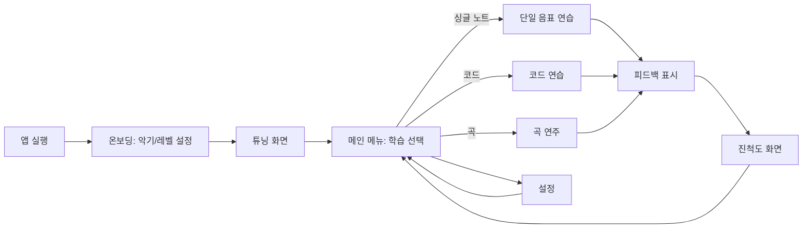

# Executive Summary  
muttan은 마이크로폰으로 실제 기타 소리를 인식해 실시간 피드백을 제공하는 SwiftUI 기반 기타 학습 앱입니다. Simply Guitar와 Yousician 같은 인기 앱들을 분석한 결과, 이들 앱은 **실시간 음정 인식**, **게임화된 학습 트랙**, **다양한 연습 코스**를 특징으로 합니다. muttan은 초기 투자 비용을 최소화하기 위해 웹 또는 iOS용 AVAudioEngine 등 오픈소스 기반의 음정 분석을 사용하며, 핵심 기능을 단계적으로 구현합니다.  

- **경쟁 분석**에서는 Simply Guitar, Yousician 외에도 Fender Play, Guitar Tricks, Justin Guitar, Rocksmith+ 등을 비교했습니다. 예를 들어, Yousician은 게이미피케이션과 실시간 점수 매기기로 동기부여를 제공하는 반면, Simply Guitar는 초심자에게 친숙한 단계별 진행과 부드러운 피드백을 제공합니다. Fender Play와 Guitar Tricks는 각기 곡 중심과 구조화된 학습 코스를 추구하며, Rocksmith+는 실제 기타로 곡을 연주하는 고몰입형 경험을 제공합니다. 이들 강점을 참고해 muttan은 **초심자에게 부담 없는 튜토리얼**, **게임 요소**, **개인 맞춤형 피드백**을 조화시킵니다.  

- **커리큘럼 설계**는 초보자→중급→고급 순으로 모듈을 구성합니다. 예를 들어, 1모듈(기초)은 튜닝, 첫 음정 연주, 간단한 스트럼, 2모듈(코드)은 기본 오픈 코드와 코드 전환, 3모듈(리듬)에서는 리듬 패턴과 템포, 4모듈(멜로디)에서는 스케일과 간단한 멜로디 연주 등을 포함합니다. 각 모듈은 학습 목표, 연습 과제, 성공 기준, 예상 소요 시간(5–15분)으로 세분화됩니다. 커리큘럼의 흐름과 종속성은 다음 머메이드 다이어그램과 표로 나타냈습니다.  

```mermaid
graph LR
    subgraph 초보자 레벨
        M1[모듈 1: 기초 (튜닝, 음정)] --> M2[모듈 2: 오픈 코드]
        M2 --> M3[모듈 3: 스트러밍 & 리듬]
    end
    subgraph 중급 레벨
        M4[모듈 4: 바레 코드]
        M5[모듈 5: 스케일 & 솔로 기초]
        M6[모듈 6: 쉬운 곡 연주]
        M3 --> M4
        M4 --> M5
        M5 --> M6
    end
    subgraph 고급 레벨
        M7[모듈 7: 즉흥 연주 & 작곡]
        M8[모듈 8: 퍼포먼스 스킬]
        M6 --> M7
        M7 --> M8
    end
```

| 모듈 | 학습 목표 | 연습 과제 | 성공 기준 | 예상 소요 |
|:----:|:----------:|:-----------|:-------------|:---------:|
| 1. 기초 | 기타 파트/자세, 튜닝, 첫 음정(E마이너) | * 기타 구조 배우기<br>* 튜너로 6번 줄 맞추기<br>* 쉬운 단일 음표 연주 | 6번 줄을 정확히 E음으로 튜닝하고 첫 음표를 올바르게 짚어 연주 | 10분 |
| 2. 초급 코드 | 오픈 코드 C, G, D, Em, A 배우기 | * 각 코드 연습 (코드 다이어그램 따라잡기)<br>* 코드 전환 연습 (2개의 코드 반복) | 2개 코드 전환을 음절 오차 1개 이내로 연속 5회 이상 성공 | 15분 |
| 3. 리듬 기초 | 기본 스트럼 패턴 (하강·상승), 간단한 리듬 | * 메트로놈에 맞춰 다운스트럼 연습<br>* 4분 음표 스트럼 반복 | 메트로놈 템포에 맞춰 8박자 이상 끊김 없이 스트럼 유지 | 10분 |
| 4. 바레 코드 | 바레 코드(A형, E형) 소개 | * 1마디당 바레 코드 전환 연습 (E 마이너 ↔ A 장) | 바레 코드 전환을 4박자 리듬으로 5회 이상 성공 | 15분 |
| 5. 멜로디/스케일 | 기본 펜타토닉 스케일, 한 음짜리 멜로디 연주 | * 펜타토닉 스케일 익히기<br>* 간단한 멜로디 모티브 연주 연습 | 음 높이 정확도 80% 이상으로 스케일 패턴을 완주 | 15분 |
| 6. 쉬운 곡 연주 | 배운 코드와 리듬으로 쉬운 곡 연주 | * 2~3개 코드로 구성된 쉬운 곡 따라치기<br>* 코러스/리프 연주 | 전체 곡의 80% 이상을 음정·리듬에 맞게 연주 | 20분 |
| 7. 응용 이론 | 스케일 확장, 코드 구성 이해 | * 메이저 스케일 연습<br>* 코드 구성(기타 이론) 간단히 학습 | 각 코드 구성음을 음계에서 인지하고 간단한 솔로 시퀀스 제작 | 20분 |
| 8. 고급 퍼포먼스 | 즉흥연주 연습, 곡 편곡 및 녹음 | * 즉흥 솔로 연습<br>* 배운 곡을 녹음하여 평가 | 16마디 이상 즉흥 솔로 구사, 자신이 녹음한 연주 평가 실습 | 30분 |

## 경쟁 서비스 분석  
다음 표는 Simply Guitar, Yousician 외 대표 기타 학습 서비스 4개를 **UX 흐름, 주요 기능, 가격 모델, 강점/약점** 중심으로 비교한 것입니다.  

| 서비스 (영문) | 접근 방식(UX) | 주요 기능 | 수익 모델 | 강점 | 약점 |
|:----:|:-----|:-----|:-----|:------|:-----|
| **Simply Guitar**<br>(심플리 기타) | 초보자 맞춤 단계별 학습<br>곡 기반 튜토리얼 | - 실시간 음정 감지<br>- 널리 알려진 곡 연주<br>- 친절한 튜토리얼 | 구독(월/년) | - 부담 없는 온보딩, 칭찬 위주 피드백<br>- 직관적 UI, 게임 요소 | - 내용 깊이/다양성 제한<br>- 고급 학습 기능 부족 |
| **Yousician**<br>(유시시언) | 게임 형식(노트 스크롤, 실시간 채점) | - 실시간 스코어링(정확도·타이밍)<br>- 10,000+ 레슨·곡, 기타/베이스/피아노/우쿨렐레<br>- 튜너, 연습 계획, 진행도 추적 | 무료 체험 + 구독 | - 높은 동기부여: 점수/스트릭/챌린지로 연습 유도<br>- 타이밍과 리듬 훈련 우수 | - 무료 시간 제한(일일)<br>- 점수 중심으로 기계적 연주 유도<br>- 기본 이론과 표현력은 보조 필요 |
| **Fender Play**<br>(펜더 플레이) | 곡 중심(짧은 동영상) | - 유명곡 중심의 단계별 레슨<br>- 깔끔한 UI/UX<br>- 기타/베이스/우쿨렐레 지원 | 구독(월 약 \$10) | - 빠른 동기부여: 단기간 성취감 제공<br>- 모던한 디자인·간결한 인터페이스<br>- 신규 사용자 친화적 | - 콘텐츠 양이 비교적 적음<br>- 상위 레벨까지 확장성 한계 가능 |
| **Guitar Tricks**<br>(기타 트릭스) | 체계적 학습 시스템 | - 수천 개 동영상 레슨<br>- Core Learning System: 기본부터 심화까지<br>- 다양한 장르, 악기 선택 | 구독(월 약 \$20) | - 방대한 강의 라이브러리(20년 누적)<br>- 탄탄한 이론+실기 커리큘럼 | - UI 복잡, 초보자에겐 다소 부담<br>- 다른 앱보다 상대적으로 비쌈 |
| **Justin Guitar**<br>(저스틴 기타) | 동영상 중심 학습 | - 세계적 강사 저스틴의 200+강 동영상 코스<br>- 구조화된 단계적 레슨(Grade 1~3)<br>- 튜너, 코드 연습 등 도구 포함 | 무료 콘텐츠 + 인앱 구독 | - 검증된 커리큘럼과 무료 고품질 콘텐츠<br>- 대규모 곡/예제 보유 | - 실시간 피드백 없음(게임 요소 부족)<br>- 구독 시 비디오 스트리밍 의존<br>- 단일 악기(기타) 중심 |
| **Rocksmith+**<br>(락스미스 플러스) | 실제 기타 연결 게임 학습 | - 실제 기타(마이크 또는 케이블)로 연주<br>- 노트 스크롤 플레이 방식, 동적 난이도 조절<br>- 방대한 스트리밍 곡 라이브러리 | 구독(월 \$10~15) | - 거대한 곡 라이브러리, 몰입감 우수<br>- 게임처럼 재미있어 장시간 연습 유도 | - 기본 이론 부족<br>- 장비(케이블, 기타)가 필요하며 비용 상승<br>- 절대 초보자에겐 학습 곡선 급격 |

## 핵심 화면 및 사용자 여정 설계  
muttan의 **사용자 여정**은 간단한 온보딩부터 시작해 튜닝→연습→피드백으로 이어집니다. 예를 들어, 최초 앱 실행 시 악기 유형(어쿠스틱/일렉, 오른손/왼손)과 실력 레벨(초심자/중급)을 묻는 페이지를 두고, 이어서 **튜닝 챌린지**를 제안할 수 있습니다. 마이크 테스트와 함께 “연결되었습니다”를 안내하며, 기타 튜닝 정도를 확인합니다.  

- **온보딩 화면**: 악기 선택(아코스틱/일렉), 동기(예: “리드 기타 마스터”, “취미 연습” 등), 약관 및 마이크 권한 요청.  
- **튜닝 화면**: 화면 중앙에 현재 소리의 주파수를 큰 숫자+바 형태로 표시. 목표 음(예: 저 E, A 등)을 회색으로 표시해 실시간 미터(cent 기준) 이동. “조금 낮아요”, “잘 맞췄어요!” 같은 안내 문구. (이와 유사하게 Uberchord 앱은 튜너 기능을 제공함.)  
- **싱글 노트 연습 화면**: Yousician처럼 노트가 화면 아래에서 위로 스크롤되거나 뮤지컬 노테이션이 표시됩니다. 플레이 버튼을 누르면 메트로놈과 함께 음표가 나오고, 사용자가 연주하면 실시간 점수가 산출됩니다. 화면 상단에 현재 점수(퍼센트나 별), 연속 성공 콤보 수 표시. “잘했어요!” 등 긍정 피드백 표시. 마이크 신호 불안정 시 “소리가 너무 작습니다” 알림.  
- **코드 연습 화면**: 연습할 코드를 다이어그램(프렛보드)으로 보여줍니다. 예: “Am 코드 잡아보세요!” 하며 코드 다이어그램과 손가락 위치 예시 제공. 사용자가 줄을 튕기면 앱이 소리를 분석하고, 잘못된 손가락 위치는 붉은색으로 하이라이트. 목표 음을 정확히 누를 때까지 실시간 안내(“첫 번째 음이 틀렸어요, 손가락을 2번 프렛에…”).  
- **곡 연주 화면**: 학습 곡은 화면을 스크롤하며 연주합니다. 마치 Rocksmith+나 Yousician처럼 타임라인(또는 노래 탭)이 흘러가며 사용자가 코드와 멜로디를 연주합니다. 특정 부분(리프)를 반복 연습할 수 있도록 섹션 루프 기능. “Try Again”과 “Next” 버튼으로 쉽게 되돌아가거나 이어나감.  
- **피드백 대시보드**: 연습 완료 후 정확도, 박자, 클린니스(소음 없는 정도)를 별점이나 퍼센트로 보여줍니다. “맞춘 음/전체 음” 비율, 틀린 음의 위치 히트맵, 주요 개선점(“코드 전환을 조금 더 연습하세요”) 제공. 다음 추천 과제로 넘어갈 수 있는 버튼.  
- **진척도 및 스테이크 화면**: 캘린더 형식으로 연습 일지를 보여주고, 연속 학습 일수, 획득한 배지(예: “10회 연속 숙제 완료”), 누적 점수 등을 표시합니다. 목표 설정 기능(예: 주 3회 이상 연습)을 두면, 달성 시 축하 메시지.  
- **설정 화면**: 오디오 입력 설정(마이크 감도, 케이블/마이크 모드), 언어 선택(예: 한국어/영어), 알림 스케줄, 개인정보 처리방침 등. 여기서 초기 설정을 조정할 수 있습니다.

대략적인 사용자 흐름을 머메이드 플로우차트로 나타내면 다음과 같습니다:  



## 실시간 피드백 인터랙션 디자인  
실시간 연주 피드백은 시각적·청각적·촉각적 요소를 복합적으로 사용합니다. 예를 들어, **시각적**으로는 Yousician/락스미스처럼 노트가 스크롤되는 화면과 정확도 막대, 채점 숫자를 보여줍니다. 음을 정확히 연주할 때 화면이 녹색으로 빛나거나 “Perfect” 메시지가 뜹니다. 오답일 경우 음표가 붉게 표시되거나 “다시 시도” 알림이 나타납니다. **청각적**으로는 메트로놈 클릭 사운드, 성공/실패 시 작은 효과음(예: 성취음, 경고음)을 넣어 피드백을 강화할 수 있습니다. **촉각적**으로는 스마트폰 진동을 활용하여 사용자가 제시된 음을 정확히 맞추면 짧게 진동주기 등으로 긍정 피드백을 주며, 잘못되면 다른 패턴을 줄 수 있습니다.  

실시간 피드백의 핵심은 **지연 최소화**입니다. 일반적으로 50ms 이내의 음성 처리 및 시각 업데이트를 목표로 합니다. 점수 규칙은 “정확도”와 “타이밍” 두 가지로 나뉩니다. 예를 들어 Yousician처럼 음정과 박자 정확도를 0~100%로 계산해 점수를 부여하고, 연속 성공 시 콤보 보너스를 줍니다. 각 음표 또는 마디 단위로 평가하여, 총점(%)과 함께 잘된 점/개선할 점을 표시할 수 있습니다. 예를 들어 “음정 정확도 92% (Great) / 타이밍 정확도 88% (Good)”처럼 점수 등급(Perfect/Good/Miss)을 부여합니다. 이를 통해 사용자는 즉시 자신의 연주 상태를 파악하고, “타이밍을 좀 더 연습하세요”와 같은 구체적 조언을 얻습니다.

## 유지율 및 참여 전략  
muttan은 사용자를 오랫동안 유지하기 위해 **게이미피케이션** 요소와 **알림/커뮤니티** 기능을 도입합니다. 예를 들면 **배지·레벨 시스템**을 구현하여 특정 목표 달성(예: “첫 7일 연속 연습”, “1000포인트 획득”) 시 배지를 지급합니다. Yousician이나 Simply Guitar처럼 **스테릭(연속 학습)**을 강조해 연속 달성 보너스를 줍니다. 매일 푸시 알림을 보내어 “오늘도 기타 연습 잊지 마세요!”라는 리마인더와 함께 짧은 연습 미션을 제공합니다. 소셜 기능으로는 연습 결과를 페이스북/Twitter 등에 공유하거나 친구와 경쟁하는 랭킹 보드를 구성할 수도 있습니다.  

콘텐츠 전략 측면에서는 **난이도 확장**과 **콘텐츠 갱신**을 고려합니다. 초기에는 기본 곡·연습을 제공하되, 점차 난이도를 올린 버전을 제공하거나 새로운 곡을 추가합니다. 예를 들어, 같은 곡을 더 빠른 템포로 반복 훈련하도록 하거나, 사용자의 진행 상황에 맞춰 자동으로 다음 과제를 추천합니다. 사용자가 좋아하는 장르의 곡을 계속할 수 있도록 큐레이션된 플레이리스트나 “이달의 곡”을 선보여 신선함을 유지합니다. 유료 전환 포인트는 기본 레슨(튜토리얼)을 무료로 제공하되, 고급 콘텐츠나 방대한 곡 라이브러리는 구독을 통해 잠금 해제하는 방식으로 합니다(앱 내 결제를 통한 프리미엄 업그레이드).

## 대상, 언어, 수익 모델 대안  
- **타겟 사용자**: 예비 기타 연주자(10대 초중반부터 30대까지)를 주 타겟으로 설정할 수 있습니다. 대안으로는 “성인 취미자(40대 이상)”나 “초중학생 교육용” 시장을 타겟으로 할 수도 있습니다. 초심자 위주로 설계하되, 나중에 중급자 과정까지 확장할 수 있게 커리큘럼을 구축합니다.  
- **지원 언어**: 초기에는 한국어와 영어로 앱을 제공해 국내외 유저를 모두 아우르는 것이 유리합니다. 대안으로는 예를 들어 “영어 단일 언어”로 시작한 뒤 성공 시 글로벌 추가(스페인어, 중국어 등)하거나, “모국어 강사(한국어, 일본어, 독일어 등)” 중심으로 틈새 시장을 공략할 수 있습니다.  
- **수익 모델**: 대부분의 경쟁 앱은 월/년 구독 모델을 택하고 있습니다. muttan도 기본 프리미엄 구독(월/년)을 메인으로 고려하며, 무료 체험 기간(예: 7일)을 제공합니다. 대안으로는 *일회성 판매*(한 번 구매 후 영구 이용) 형태의 비즈니스 모델을 고려할 수 있습니다. 예컨대 Jamorama 방식처럼 전체 과정을 한 번에 구매하게 하거나, 특정 고급 모듈(바레 코드 패키지 등)을 개별 과금할 수도 있습니다. 또 다른 대안으로는 광고 수익 기반의 무료 앱 모델을 채택하여, 중간 광고나 인터스티셜 배너로 수익을 얻고 유료 업그레이드를 옵션으로 제공할 수 있습니다.

## KPI 및 A/B 테스트 아이디어  
초기 성공을 측정할 KPI로는 **사용자 유지율(1일/7일/30일 Retention)**, **일일·주간 연습 횟수(DAU/WAU)**, **레슨 완료율(수강률)**, **평균 연습 시간**, **레슨별 정확도 증가율** 등을 설정할 수 있습니다. 예를 들어, “7일 후에도 30% 이상의 사용자가 앱을 재방문”이 목표가 될 수 있습니다. 또 **구독 전환율**(무료 체험 대비 유료 가입자 비율)과 **평균 결제 가격(ARPU)**도 중요합니다. 사용자 학습 성과 측면에서는 “한 달 내에 C 메이저 코드 80% 정확도 달성” 같은 학습 성취도를 지표로 둘 수 있습니다.  

A/B 테스트 아이디어는 다음과 같습니다.  
- **온보딩 간소화 vs 상세화**: 초기 온보딩 시 악기/레벨 선택 단계를 간단히 할지, 추가 질문(목표, 경험 등)을 넣을지 비교 테스트.  
- **UI/컬러 테마**: 게임 느낌의 컬러(밝고 화려한 배경) 대 심플 모던 테마(어두운 배경 + 네온) UI 중 어느 쪽이 사용자 몰입도와 연습 시간을 증가시키는지.  
- **알림 빈도**: 매일 리마인더, 주 3회 리마인더 등의 알림 빈도를 다르게 설정하여 학습 참여율 변화를 관찰.  
- **과제 제시 방식**: 미션/퀘스트 형태로 제시 vs 목록형 학습 흐름 중 어떤 방식이 완료율을 높이는지.  
- **구독 프로모션**: 7일 무료체험 대 14일 무료체험, 월간 대 연간 결제 할인율 등 구독 조건을 달리하여 전환율을 측정합니다.

## 결론 및 우선순위 MVP (12주 로드맵)  
**우선순위 MVP**는 **핵심 기능** 구현에 중점을 둡니다. 예를 들어: 튜닝 기능, 단일 음정 인식 게임, 기본 코드 연습, 간단한 진행도 대시보드, 첫 번째 AI 피드백(예: 음정 오류 안내) 등이 MVP 1.0의 목표입니다. 고급 기능(모든 코드, 대규모 곡 라이브러리, SNS 공유 등)은 v2 이후로 연기합니다. 초기 사용자(개발자 본인)를 위해 라이선스 걱정 없는 샘플 곡과 연습자료로 시작합니다.

12주 로드맵(주 단위)은 다음과 같습니다:  

- **1–2주**: 개발 환경 구성 및 오디오 캡처 엔진 구축. AVAudioEngine/Swift AudioKit 설정, 튜닝 기능 프로토타입(실시간 FFT로 기타 소리 주파수 검사) 개발.  
- **3–4주**: 단일 음정 인식 구현. YIN 알고리즘 또는 FFT 피크 검출을 통해 마이크 입력에서 음정 추출. “첫 음정 맞추기” 게임 형태 UI 제작.  
- **5–6주**: 간단한 스트러밍 및 피드백 로직 추가. 정확도 계산(성공/실패 판정) 및 기본 점수 산출. 실시간 점수 표시 UI.  
- **7–8주**: 코드 연습 기능 추가. 오픈 코드(A, C, G 등) 패턴 데이터 구축 후 코드 인식 알고리즘 통합. 코드 다이어그램 UI와 “코드 잡기” 미션 구현.  
- **9–10주**: 학습 흐름과 데이터 저장. 사용자 진행 상태 저장(DB 또는 로컬 저장), 여러 레슨 연결(튜토리얼 흐름 구성). 피드백 대시보드 UI(정확도, 연습 시간 통계) 제작.  
- **11주**: 작은 A/B 테스트와 튜닝. 사용자 인터랙션 개선(버튼 크기, 문구, 애니메이션) 및 초기 콘텐츠(곡 예제) 추가. 초기 KPI(예: 정확도 향상, 연습 지속 여부) 평가.  
- **12주**: 베타 버전 완성 및 문서화. 핵심 버그 수정, 소셜 로그인/공유 옵션 추가 (필요 시). 구독 결제 시스템 간단히 연동. 향후 작업 계획(정식 출시 전까지 개선할 사항) 정리.  

이 계획대로 진행할 경우, 12주 차에는 “가장 쉬운 곡 1곡”을 포함해 기본적인 학습 루프가 완성됩니다. 이후 사용자 피드백(AI 개인 코칭 추가, 더 많은 레슨) 등을 통해 앱을 고도화할 수 있습니다. muttan은 위 분석과 로드맵에 따라 단계적으로 개발을 진행하여 초기 버전부터 탄탄한 사용자 경험을 제공할 것입니다.


