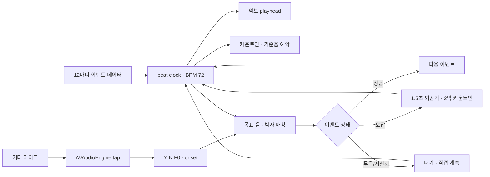

# 기타 연주·학습 기술 조사 계획

## 목적

muttan은 코드 사전과 기타 튜너를 구현했고, 다음은 `연습`과 `곡` 흐름을 확장하려 한다. 이 조사는 기능 이름을 나열하는 데 그치지 않고 다음을 결정하기 위한 기술 근거를 만든다.

- 어떤 연주 입력을 인식할지: 단음, 반복음, 코드, 스트럼, 리듬
- 각 입력을 실시간으로 인식할 때 필요한 신호 처리와 시간 허용 범위
- 현재 기기의 마이크와 오디오 엔진으로 가능한 범위 및 물리 기기 검증이 필요한 범위
- 사용자에게 피드백·반복·구간 이동을 언제 보여줄지
- 기술의 목적에 맞춰 어떤 시제품 순서로 구현할지

현재 제품 계획의 첫 시제품은 C장조 단음 멜로디 `비행기`를 12마디로 연주하며 따라 치는 흐름이다. 같은 음을 반복해서 치는 구간, 정답·오답 이벤트, 박자 진행, 1.5초 되감기와 카운트인이 포함된다. 화음 인식, 연습 기록·점수는 이번 시제품 범위가 아니다. 이 기술 조사는 [연습 시제품 계획](../../plans/song-practice.md)을 기준으로 한다.

타 서비스별 UI·UX·기술·커리큘럼·기능 조사와 종합 비교는 [타 서비스 조사 폴더](../other-services/README.md)에 분리했다.

## 1차 판단

- 오디오 입력은 지금 쓰는 `AVAudioEngine` 경로를 유지하고, 요청 4096프레임이 아니라 실제 버퍼와 end-to-end 지연을 잰다.
- 음정 판정은 YIN/CMNDF를 기준선으로 삼는다. 기타 연구에서도 실시간 단음 후보로 보고됐지만, 현재 앱 환경의 성능은 미측정이다.
- 반복음/리듬은 새 onset 시각이 필요하다. 현재 pitch detector는 F0 하나만 반환하므로 별도 onset 분석을 둔다.
- 곡 타깃의 beat는 앱이 미리 알기 때문에 초기에는 tempo detection 대신 BPM 72 고정 beat clock으로 정렬한다.
- beat time은 기준 시각 + 정수 beat index로 계산해 멈춤·재시작·복구 뒤에도 누적 오차를 줄인다.
- 계획된 ±35% timing window는 72 BPM에서 약 ±292ms다. 첫 구현 입력값으로 보되 정답률/사용자 체감 측정으로 조정 여부를 판단한다.
- 두 박 카운트인·기준음은 `AVAudioPlayerNode`에서 작은 PCM sample을 예약하는 경로부터 검토한다. 반주 재생 엔진이나 복잡한 sequencer는 아직 필요하지 않다.
- 오답 재시작은 이벤트 playhead를 되감고 beat anchor를 보존한다. 다중음·범용 곡 전사는 현재 목표에 넣지 않는다.

## 첫 시제품의 기술 흐름



beat clock과 UI/출력은 앱이 알고 있는 곡 타임라인을 공유한다. 마이크는 실제 음·타격의 시각을 제공하며 clock에 맞춰 평가된다. 사용자 입력이 멈췄을 때 어떤 시간이 정지하고 무엇이 유지되는지는 [동기화·복구 문서](alignment-and-recovery.md)에 명시한다.

악보/타브 이벤트는 재생 시각과 운지 안내를 같이 보관한다. 예를 들어 표준 튜닝 2번 현 1프렛은 C4(MIDI 60)다.

```json
{
  "bar": 1,
  "beat": 0,
  "durationBeats": 1,
  "midi": 60,
  "string": 2,
  "fret": 1
}
```

## 기술 지도

| 범주 | 해결할 문제 | 대표 기술·접근 | 주 사용 목적 | 시제품 우선순위 |
| --- | --- | --- | --- | --- |
| 오디오 입력·세션 | 마이크 입력을 안정적으로 열고 화면 이동·전화·백그라운드에 안전히 대응 | AVAudioSession, AVAudioEngine input tap, 샘플레이트·버퍼 설정, 오디오 라우트·인터럽션 관리 | 튜너와 연습 중 입력 수명 주기 관리 | 필수 |
| 신호 품질·유효 소리 판별 | 무음·잡음·버징·약한 입력을 음으로 오인하지 않기 | RMS/에너지 문턱, 클리핑·신뢰도 검사, 신호 안정화, 무음 만료 | 오답 판정 전에 입력 유효성 확인 | 필수 |
| 단음 높이 추정 | 실제로 울린 음의 기초 주파수/MIDI 높이를 구하기 | YIN/CMNDF, 자기상관, McLeod 계열, FFT 기반 스펙트럼 피크; 하모닉 오류와 옥타브 오류 분석 | 튜너, `비행기` 단음 멜로디 | 필수, 기존 YIN부터 평가 |
| 음 시작점·재발음 검출 | 같은 음을 연속으로 튕긴 것을 각각의 타격으로 구분 | 에너지 상승, spectral flux/onset strength, refractory window, 피치 변화와 무음 경계 | `C4-C4`, `A4-A4` 등 반복 음 이벤트와 박자 판정 | 단음 연습의 핵심 |
| 목표 음 매칭 | 추정 음과 과제의 목표 음을 맞는/높은/낮은/다른 음으로 분류 | MIDI 최근접, cent 차이, 허용창, 여러 프레임 연속 확인, 히스테리시스 | 프렛별 단음·튜닝 판정 | 필수 |
| 리듬·박자 정렬 | 연주 시작 시각과 과제의 박·세분박 비교 | 단조 시계 기반 beat clock, 앱 기준 템포, onset timestamp와 허용 구간 비교, 지연 보정 | 12마디 멜로디의 목표 박자 정렬 | 필수 |
| 구간 재생·오류 복구 | 틀린 곳에서 자연스럽게 멈추고 짧게 되감아 다시 시도 | 이벤트 시퀀서, playhead, measure/phrase loop, 재시작 상태 머신, 재진입 잠금 | 계획된 1.5초 되감기·2박 카운트인·자동 재개 | 필수 경험 설계 |
| 화음·스트럼 인식 | 여러 현의 동시 발음과 스트럼 방향·리듬을 식별 | 다중 F0/스펙트럼 템플릿, 코드 톤 판별, 스트럼 온셋·에너지 패턴; 단음 추정기와 별도 문제 | 이후 코드·곡 연주 | 후순위, 별도 타당성 조사 |
| 악보·타브 모델 | 음악 이벤트를 사람이 읽는 음표/현·프렛/길이로 표현 | 내부 이벤트 JSON, MIDI 노트·박자, MusicXML/타브 포맷 검토 | 연습 데이터 및 곡 콘텐츠 | MVP에는 작은 내부 스키마 |
| 화면 동기화·피드백 | 입력 지연이 있어도 화면·소리·연주 박을 일관되게 유지 | 오디오 캡처 시각, monotonic clock, 지연 예산, UI 상태 스냅샷, 햅틱/시각 피드백 | 사용자가 다음 음과 현재 상태를 이해 | 필수 |
| 권한·개인정보·접근성 | 입력 중임을 명확히 하고 안전하게 중단·복구 | 최소 권한, 오디오 영구 저장 금지, 백그라운드 중지, VoiceOver, 색 외 상태 부호 | 신뢰·안전·사용성 | 필수 |

## 기술 범주별 조사 질문

### 1. 입력과 지연

- `AVAudioEngine` tap의 현재 버퍼 4096프레임, 실제 샘플레이트에서 입력부터 UI 반응까지 몇 ms가 걸리는가?
- 더 작은 버퍼가 단음 반응을 빠르게 하지만 누락·CPU 부하를 만들지 않는가?
- `setPreferredIOBufferDuration` 요청은 어떤 기기·라우트 조건에서 실제 적용되는가?
- 스피커로 재생한 기준음과 마이크 입력을 동시에 쓸 때 에코·피드백이 음정 검출을 오염시키는가?
- 튜너 탭과 연습 세션에서 오디오 세션을 한 번만 소유하고 깨끗하게 넘길 수 있는가?

### 2. 단음 추정과 신뢰도

- 현재 YIN 구현은 60–1000 Hz, 4096프레임, clarity 0.75 문턱을 쓴다. `비행기`의 C4–A4 계열 목표음에서 onset 직후/잔향 중 성능, 반복음 처리, 다른 안정된 음의 오답 분류를 측정한다.
- 기타 배음이 기본음보다 강할 때 옥타브 위로 오인하는 비율은 얼마인가?
- 후보 알고리즘은 평균 정확도보다 목표 음 근처의 편향, 오답 음과의 분리, 계산 시간, 환경 소음에서 비교한다.
- PRD 이벤트는 현·프렛과 음높이를 함께 가진다. 그래도 음높이만으로 현·옥타브·운지를 역추정할 수 있다고 가정하지 않는다. 같은 pitch가 다른 위치에서 날 수 있는 모호성은 화면 안내와 음높이 판정을 분리한다.

### 3. 음 시작점과 반복음

- 피치가 그대로인 연속 타격은 pitch tracker만으로 분리할 수 없다. 초보가 다음 음을 칠 때까지 기다리는 기준으로 단순 RMS 하강·상승을 쓸 수 있는가?
- 현을 계속 울리는 사용자는 충분한 무음 없이 재타격할 수 있다. 에너지 변화와 spectral flux 기반 onset을 비교한다.
- 잘못된 시작점에서 되감지 않게 onset timestamp를 원래 오디오 캡처 시각에 연결한다.

### 4. 리듬과 타임라인

- 현재 계획은 BPM 72의 고정된 12마디 타임라인과 ±35% 입력 창을 쓴다. 앱이 만든 곡 이벤트를 연주하므로 초기에는 오디오에서 곡의 템포를 추정하지 않고 이 기준 시계와 마이크 onset을 정렬한다.
- 세션 시각은 `Date`가 아닌 단조 증가 시계로 계산하여 화면 잠금·시계 변경에도 흔들리지 않게 한다.
- 오디오 입력 프레임·분석 큐·UI 갱신 지연을 각각 계측하여 시스템 지연과 사용자의 박자 오차를 혼동하지 않는다.

### 5. 데이터·화면 동기화와 오류 복구

- 과제 데이터는 `string`, `fret`, `midi`, `beat`, `duration`, `repeatGroup`을 가진 이벤트로 표현할 수 있는가?
- 상태 머신은 대기 → 안내 → 입력 듣기 → 정답/오류 → 짧은 숨 고르기 → 같은 부분 재시작으로 설계한다.
- 같은 오류 이벤트에서 여러 콜백이 들어와 되감기를 중복 실행하지 않도록 이벤트 ID/세션 세대값을 쓴다.
- 소리 없음은 오답이 아니다. 허용 시간 초과 때는 자동 건너뛰기보다 `다시 들어볼게요`와 직접 계속하기를 검토한다.
- 제품 계획의 1.5초 되감기와 2박 카운트인을 이벤트/beat anchor에 맞춰 구현한다. 재시작 기준(앞서 1.5초, 직전 박, 마디 시작)이 자연스러운지는 first-use 실기기 관찰 후에만 변경한다.

## 목적별로 기술 사용하기

| 제품 목적 | 필요한 기술 조합 | 이 조합이 충분한 조건 | 쓰지 말아야 할 과한 접근 |
| --- | --- | --- | --- |
| 튜너 | 오디오 입력 + 단음 F0 추정 + cent 비교 + 안정화 | 한 번에 한 현을 튜닝할 때 | 화음 인식·악보 정렬 |
| `비행기` 따라 치기 | 단음 F0 + onset 분리 + 알려진 MIDI/현/프렛 이벤트 + BPM timeline + pitch/timing gate + 오류 복구 상태 머신 | 앱이 미리 정의한 멜로디 한 파트를 연주할 때 | 곡 음원에서의 자동 타브/코드 전사, 음원 분리 |
| 독립 리듬 패턴 | onset 검출 + 기준 박자 시계 + 타이밍 오차 표시 | 짧고 반복되는 리듬과 한 입력 파트일 때 | 즉시 음악 장르/스타일 분류 |
| 코드 연습 | 동시 발음 코드 분류 + 스트럼 onset/리듬 검출 | 사용자가 코드 하나 또는 두 개를 번갈아 연주할 때 | YIN 한 음 추정값 하나를 화음 판정처럼 사용 |
| 곡 따라 연주 | 악보/타브 이벤트 + F0/onset + timeline sync + 구간 반복 | 구조화된 단음 또는 단순한 코드 파트일 때 | 자유 연주 전체를 채점하는 범용 모델 |
| 백킹 트랙 연주 | 오디오 재생/라우팅 + 입력 격리 + 타임라인·지연 보정 | 헤드폰 또는 충분히 분리된 오디오 출력이 있을 때 | 스피커 재생 간섭을 무시한 마이크 채점 |

## 조사 및 판단 순서

1. **현재 기준선 기록**: [`PitchDetector.swift`](../../../muttan/Features/Practice/PitchDetector.swift), [`TunerSignal.swift`](../../../muttan/Features/Practice/TunerSignal.swift), [`TunerView.swift`](../../../muttan/Features/Practice/TunerView.swift)의 구현 가정(입력 포맷, 버퍼, 범위, 필터, 세션 수명)을 코드 근거로 기록한다.
2. **이론과 대안 조사**: YIN 원논문, 자기상관·McLeod/MPM, spectral flux/onset 검출, Apple 오디오 세션·버퍼 문서를 비교하고 기술별 장단점 표를 만든다.
3. **실제 연주 조건 정의**: 표준 튜닝, 목표 C4–A4, 곡에 포함된 반복음, 현·프렛 배정, 거리, 잡음, 프렛 버징, 초보 타이밍 변동을 케이스로 정의한다.
4. **작은 비교 프로토콜**: 실제 iPhone과 acoustic guitar를 사용해 곡의 반복 구절 및 오류 시나리오를 재생한다. 목표 음 오답률, 무응답률, onset 누락/중복, 박자 오차, 되감기 발동 시점, 지연, CPU 사용량을 기록한다. 앱은 오디오를 영구 보관하지 않으며 연구용 별도 녹음은 로컬·폐기 정책을 명시한다.
5. **MVP 결론**: 기존 YIN + 단순 onset 기준선으로 12마디 단음 melody가 가능한지 평가하고, 고정 BPM timeline·pitch/timing gate·retry 상태 머신을 검증한다. 현 입력에서 오류 근거가 나타난 경우에만 다른 알고리즘을 비교한다.
6. **후속 분야**: melody loop가 안정되면 독립 리듬 훈련, 제한된 chord recognition, 마지막으로 자유곡/반주 입력을 조사한다.

각 조사 결과는 이 폴더에 주제별 문서로 둔다. 문헌 및 휴대폰 자료를 비교할 지표·케이스는 [평가 자료와 비교 절차](evaluation-protocol.md)에 정의한다. 결론을 바꿀 실험·근거가 없다면 기술 문서를 반복 작성하지 않는다.

## 1차 조사 결과

아래 결론은 문헌·공식 API와 현재 소스 검토에 따른 초기 판단이다. 아직 iPhone 실측 결과가 아니며, 성능 수치로 오해하지 않도록 한다.

- **입력 경로는 AVAudioEngine + input node tap으로 유지한다.** Apple은 입력 노드의 하드웨어 포맷에서 샘플레이트와 채널 수가 유효한지 확인하도록 안내한다. Tap은 요청한 버퍼 크기를 그대로 보장하지 않고, 콜백은 메인 스레드가 아닐 수 있다. 따라서 4096프레임을 지연 시간 그 자체로 취급하거나 tap 안에서 SwiftUI 상태를 변경하면 안 된다. 현재 구현은 별도 분석 큐를 사용하므로 이 경계를 유지하고, 실제 콜백 프레임 수·시각·현재 I/O 버퍼를 계측한다.
- **오디오 지연은 여러 시간 단위로 나눠 본다.** 하드웨어 I/O 버퍼, tap callback의 실제 frameLength, F0 분석 윈도, 다음 분석까지의 hop/cadence, serial queue 대기, 메인 UI 갱신은 서로 다른 구간이다. 코드에서 tap은 4096프레임을 요청해 한 버퍼 전체를 분석하고, 결과를 main actor로 넘긴다. 실제 프레임 수·콜백 간격을 측정하기 전에는 이 경로의 체감 지연을 수치화하지 않는다.
- **현재 캡처 시각은 리듬 채점용 정밀 타임스탬프가 아니다.** `TunerView`는 tap의 `AVAudioTime`을 사용하지 않고 콜백 진입 후 `systemUptime`을 기록한다. Apple의 `AVAudioTime`은 host/sample time 중 하나 또는 둘 다를 가질 수 있으므로 validity flag를 확인해야 한다. 현재 튜너 표시에서는 콜백 근사치로 가능하나, onset 오차를 재려면 오디오 프레임 시각과 처리/UI 지연을 분리해야 한다.
- **현재 단음 YIN은 합리적인 출발 기준선이다.** 앱 코드가 CMNDF(YIN 변형)와 clarity/RMS 거절을 이미 사용한다. 음성·음악 원 논문에 더해 기타 실시간 추적 비교에서도 YIN이 낮은 지연의 단음 후보로 보고되었으나, 실기타에서 옥타브 점프와 주파수 흔들림이 관찰됐다. 이 근거는 기본 알고리즘으로 유지할 이유이지 기타 초보 마이크 입력의 정확도를 보증하지 않는다. aubio는 YIN, YINFFT, YINFAST, comb 계열 등 구현 가능한 대조군을 문서화한다. 다음 비교 후보는 교체가 아닌 동일 입력 비교다.
- **MPM을 두 번째 후보로 검토한다.** McLeod–Wyvill의 MPM은 정규화된 squared-difference 기반이며 신호의 tonal clarity 지표를 포함한다. 현재 코드의 clarity 개념과 비교하기 좋지만, 문헌 수치만으로 우열을 단정하지 말고 동일한 기타 샘플과 지연 조건에서 검증한다.
- **반복 타격은 pitch 추정과 별도 문제로 다룬다.** 같은 높이의 음을 다시 튕기면 음정 추정값만으로 새 타격을 확정할 수 없다. 1차는 에너지 변화 + 최소 재검출 간격의 간단한 baseline으로 시작하고, 지속음/연타/배경 잡음에서 누락과 중복이 남을 때 spectral flux 계열 onset을 대조군으로 추가한다. aubio 문서에는 energy, spectral flux 등 onset 계열 선택지가 있다.
- **다음 구현 결정을 미룰 수 있는 부분:** 코드/다중음 인식, 범용 자동 전사, 신경망 교체. 첫 과제의 타깃 음·박자·현·프렛은 앱 데이터로 이미 알려져 있어, 곡 전체 전사 모델을 도입할 근거가 없다.

주제별 조사와 결정 기록은 [오디오 입력](audio-capture.md), [단음 음정 추정](pitch-detection.md), [온셋·리듬](onset-and-rhythm.md), [코드·스트럼](chords-and-strums.md), [동기화·복구](alignment-and-recovery.md), [평가 자료와 비교 절차](evaluation-protocol.md)에서 이어간다.

## 이번 조사에서 확인할 실측값

다음 표의 값은 아직 미측정이다. 하드웨어·OS·오디오 라우트별로 기록한다.

| 측정값 | 왜 필요한가 | 기록 방법 |
| --- | --- | --- |
| tap 콜백 프레임 수와 간격 | 요청 버퍼와 실제 입력 단위 차이 확인 | `AVAudioTime` host time 및 `frameLength` |
| F0 분석 윈도·hop·처리 주기 | 분석 프레임 길이와 새 판정 빈도의 차이 파악 | frameLength, 처리 구간, callback/capture 시각을 각각 기록 |
| callback/drop, queue 대기, 캡처부터 UI까지 p50/p95 | 입력 지연과 버려진 입력이 수집·분석·UI 중 어디서 생기는지 분리 | callback 실행시간, permit drop, 분석 시작/종료, UI 반영 시각 기록 |
| 목표 음 혼동률·미검출률 | 오답 판정과 무반응 분리 | C4–A4, 반복음, 약한 타격·배음이 강한 타격을 라벨링 |
| 온셋 지연·중복·누락률 | 반복음 진행과 되감기 트리거 품질 | 기준 타격 시각과 검출 시각 비교 |
| 발열·CPU·오디오 중단 | 긴 연습에서 안정성 | 같은 길이 세션을 기기별 반복 측정 |

첫 비교는 현재 YIN과 단순 onset baseline으로 제한한다. 오류 유형이 분명히 남을 때만 MPM/YINFFT 또는 spectral flux를 추가해 비교한다.

## 우선 참고 출처

- Apple, [`AVAudioEngine`](https://developer.apple.com/documentation/avfaudio/avaudioengine) 및 입력 노드 오디오 tap 문서.
- Apple, [`setPreferredIOBufferDuration`](https://developer.apple.com/documentation/avfaudio/avaudiosession/setpreferrediobufferduration%28_%3A%29): 버퍼 설정 API. 요청값이 기기에서 그대로 적용된다고 가정하지 않고 실기기에서 측정한다.
- Apple, [`AVAudioTime`](https://developer.apple.com/documentation/avfaudio/avaudiotime), [`AVAudioPlayerNode`](https://developer.apple.com/documentation/avfaudio/avaudioplayernode): 입력 sample/host timestamp와 기준음·카운트인 예약 재생의 시간 기준.
- Apple, [`measurement` audio session mode](https://developer.apple.com/documentation/avfaudio/avaudiosession/mode-swift.struct/measurement), [Bluetooth HFP routing option](https://developer.apple.com/documentation/avfaudio/avaudiosession/categoryoptions-swift.struct/allowbluetooth): 현재 입력 경로와 마이크/스피커 라우팅 특성.
- de Cheveigné & Kawahara, [“YIN, a fundamental frequency estimator for speech and music”](https://pubmed.ncbi.nlm.nih.gov/12002874/), 2002: 단음 F0 대안의 기준 논문.
- von dem Knesebeck & Zölzer, [“Comparison of Pitch Trackers for Real-Time Guitar Effects”](https://dafx10.iem.at/papers/VonDemKnesebeckZoelzer_DAFx10_P102.pdf), DAFx 2010: dry electric guitar의 단음 비교. 앱 환경으로 일반화하지 않는다.
- Böhler & Zölzer, [“Monophonic Pitch Detection by Evaluation of Individually Parameterized Phase Locked Loops”](https://www.dafx.de/paper-archive/2016/dafxpapers/35-DAFx-16_paper_22-PN.pdf), DAFx 2016: GuitarSet 계열 단음 자료에서 pYIN 등 비교 및 pitch/onset 검출률.
- Nieradzik, [SwiftF0 preprint (2025)](https://arxiv.org/abs/2508.18440): 소형 신경망 단음 F0 후보. 공개 자료 결과라 휴대폰 기타 입력 우열로 일반화하지 않는다.
- McLeod & Wyvill, [“A Smarter Way to Find Pitch”](https://www.cs.otago.ac.nz/graphics/Geoff/tartini/papers/A_Smarter_Way_to_Find_Pitch.pdf), ICMC 2005: MPM과 clarity 산출 방식. 구현 비교 후보이지 앱 정확도 근거는 아니다.
- aubio, [Analysis API](https://aubio.org/manual/latest/py_analysis.html), [CLI 알고리즘 설명](https://aubio.org/manual/latest/cli.html): pitch/onset/tempo 대조군과 알고리즘 계열 목록.
- [Musical note onset detection based on a spectral sparsity measure](https://pmc.ncbi.nlm.nih.gov/articles/PMC8550344/): 온셋 검출 배경과 현악기 onset 연구. 앱 채택 전 낮은 복잡도의 단순 baseline과 비교한다.
- Fender·Simply·Yousician 등 제품 조사에서 확인된 실사용 패턴은 [서비스별 기술 문서](../other-services/simply-guitar/02-technology.md), [Yousician](../other-services/yousician/02-technology.md), [Fender Play](../other-services/fender-play/02-technology.md), [Justin Guitar](../other-services/justinguitar/02-technology.md), [Ultimate Guitar](../other-services/ultimate-guitar/02-technology.md), [Guitar Tricks](../other-services/guitar-tricks/02-technology.md) 및 [종합 UX 비교](../other-services/synthesis.md)를 참고하되, 경쟁사 내부 알고리즘으로 오인하지 않는다.

## 비범위·주의

- 정확한 채점식·신경망·서버 처리에 관한 근거가 없으면 추정값을 사실처럼 문서화하지 않는다.
- 목표는 앱 스토어용 범용 노래 채점 엔진을 만드는 것이 아니라 개인 기타 연습에서 따라 치고 즉시 이해할 수 있는 입력·피드백이다.
- 구체 알고리즘 선정과 구현은 비교 근거를 쌓은 뒤 한다. 이 README는 기술 조사 계획이며 구현 명세가 아니다.
